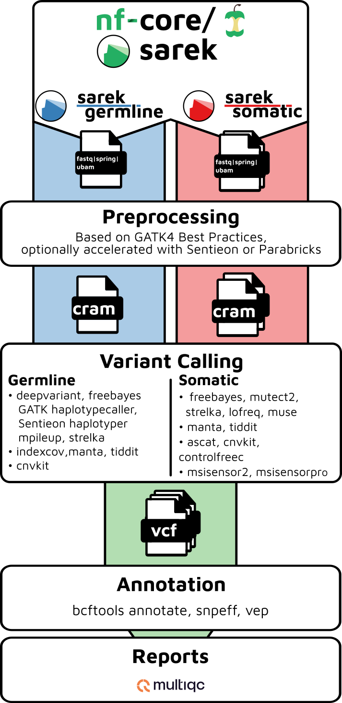
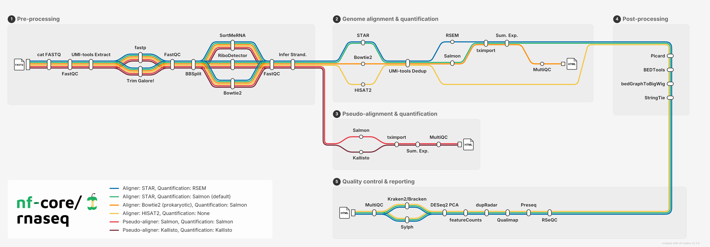
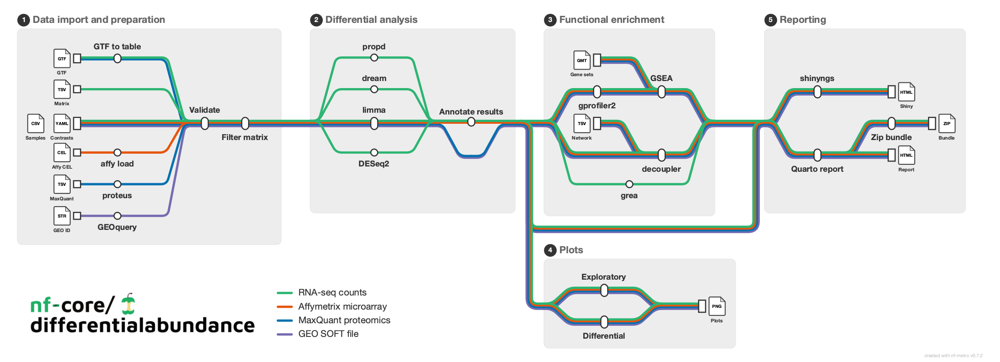

## Introduction

This is a workflow designed to work with genomics data at the [Perkins Cancer Biobank (PCB)](https://perkins.org.au/research/disease/cancer/cancer-biobank/). The pipeline is based on **nf-core/sarek**,  **nf-core/createpanelrefs**, as well as many other **nf-core** [subworkflows](https://nf-co.re/subworkflows) and [modules](https://nf-co.re/modules) to incorporate different analyses for Whole Exome Sequencing data analyses at PCB.
**sarek_pcb** inherits almost everything from **nf-core/sarek** and integrated other relevant modules such as **Panels of Normal** construction, tumour purity estimation by **pureCN**, etc.

It also includes **nf-core/rnaseq** and **nf-core/differentialabundance** for RNASeq data analysis. Not all tools are needed for our own business though.
(More coming in the future...)



<p align="right">
     
    
</p>

## Pipeline summary


## Usage

> [!NOTE]
> If you are new to Nextflow and nf-core, please refer to [this page](https://nf-co.re/docs/get_started/environment_setup/overview) on how to set-up Nextflow. Make sure to [test your setup](https://nf-co.re/docs/get_started/run-your-first-pipeline) with `-profile test` before running the workflow on actual data.

First, prepare a samplesheet with your input data that looks as follows:

`samplesheet.csv`:

```csv
patient,sample,lane,fastq_1,fastq_2
ID1,S1,L002,ID1_S1_L002_R1_001.fastq.gz,ID1_S1_L002_R2_001.fastq.gz
```

Each row represents a pair of fastq files (paired end).

Now, you can run the pipeline using:

```bash
nextflow run main.nf \
   -profile <docker/singularity/.../institute> \
   --input samplesheet.csv \
   --outdir <OUTDIR>
```

> [!WARNING]
> Please provide pipeline parameters via the CLI or Nextflow `-params-file` option. Custom config files including those provided by the `-c` Nextflow option can be used to provide any configuration _**except for parameters**_; see [docs](https://nf-co.re/docs/running/run-pipelines#using-parameter-files).

For more details and further functionality, please refer to the [usage documentation](https://nf-co.re/sarek/usage) and the [parameter documentation](https://nf-co.re/sarek/parameters).

## Pipeline output

To see the results of an example test run with a full size dataset refer to the [results](https://nf-co.re/sarek/results) tab on the nf-core website pipeline page.
For more details about the output files and reports, please refer to the
[output documentation](https://nf-co.re/sarek/output).


## Credits

Sarek was originally written by Maxime U Garcia and Szilveszter Juhos at the [National Genomics Infastructure](https://ngisweden.scilifelab.se) and [National Bioinformatics Infastructure Sweden](https://nbis.se) which are both platforms at [SciLifeLab](https://scilifelab.se), with the support of [The Swedish Childhood Tumor Biobank (Barntumörbanken)](https://ki.se/forskning/barntumorbanken).
Friederike Hanssen and Gisela Gabernet at [QBiC](https://www.qbic.uni-tuebingen.de/) later joined and helped with further development.

The Nextflow DSL2 conversion of the pipeline was lead by Friederike Hanssen and Maxime U Garcia.

Maintenance is now lead by Friederike Hanssen (now at [Seqera](https://seqera.io)) and Maxime U Garcia.


## Acknowledgements


## Contributions & Support


## Citations

Please cite the `Sarek` article as follows:

> Friederike Hanssen, Maxime U Garcia, Lasse Folkersen, Anders Sune Pedersen, Francesco Lescai, Susanne Jodoin, Edmund Miller, Oskar Wacker, Nicholas Smith, nf-core community, Gisela Gabernet, Sven Nahnsen **Scalable and efficient DNA sequencing analysis on different compute infrastructures aiding variant discovery** _NAR Genomics and Bioinformatics_ Volume 6, Issue 2, June 2024, lqae031, [doi: 10.1093/nargab/lqae031](https://doi.org/10.1093/nargab/lqae031).


You can cite the `nf-core` publication as follows:

> **The nf-core framework for community-curated bioinformatics pipelines.**
>
> Philip Ewels, Alexander Peltzer, Sven Fillinger, Harshil Patel, Johannes Alneberg, Andreas Wilm, Maxime Ulysse Garcia, Paolo Di Tommaso & Sven Nahnsen.
>
> _Nat Biotechnol._ 2020 Feb 13. doi: [10.1038/s41587-020-0439-x](https://dx.doi.org/10.1038/s41587-020-0439-x).

## CHANGELOG

- [CHANGELOG](CHANGELOG.md)
